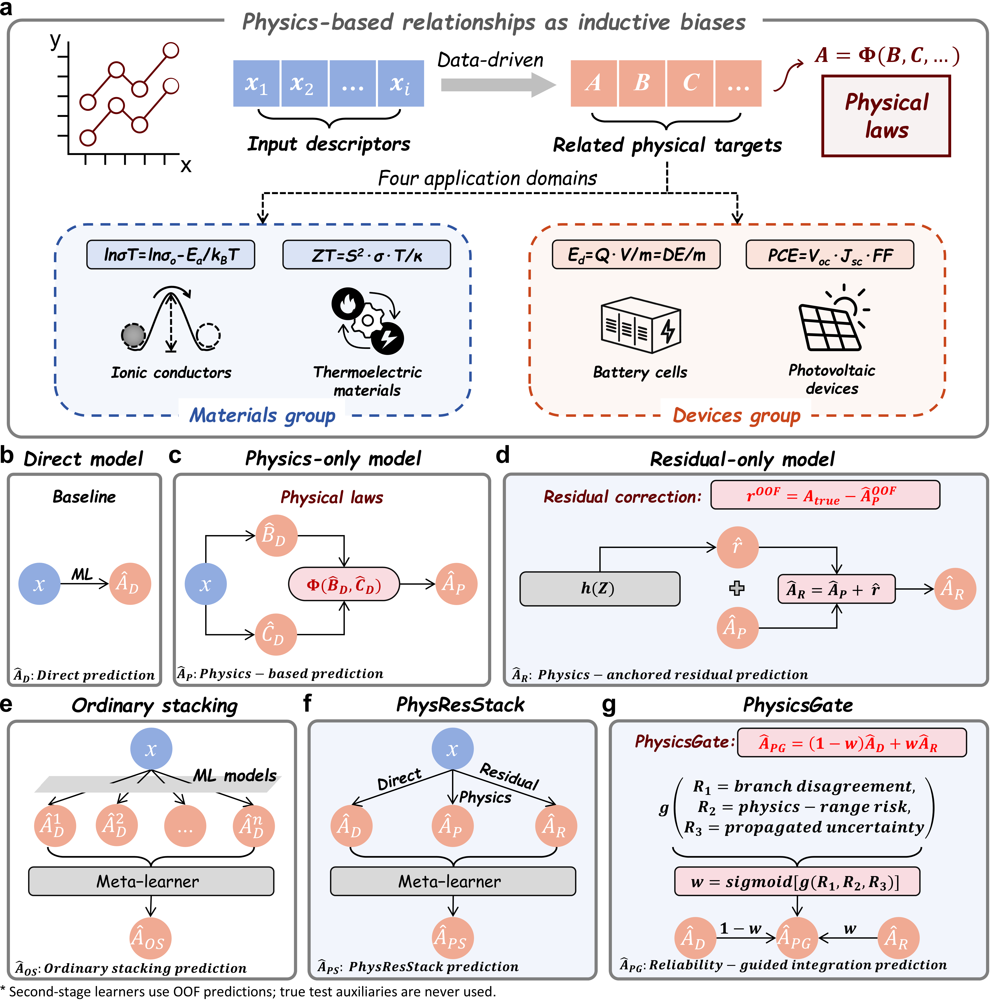

# PhysicsGate

Code and data for *Learning when to use physical relationships in
descriptor-based tabular machine learning*. PhysicsGate combines a direct
prediction with a physics-anchored residual prediction through a
sample-specific reliability weight, and the benchmark tests when an explicit
physical relationship among predicted properties improves prediction.

## Method

For a target property, PhysicsGate combines a direct prediction and a
physics-anchored residual prediction:

$$
\hat A_{PG}
= (1-w)\hat A_D+w\hat A_R
= \hat A_D+w(\hat A_R-\hat A_D),
\quad 0 \leq w \leq 1.
$$

The residual branch first corrects the equation-derived prediction:

$$
\hat A_R=\hat A_P+\hat r.
$$

The physics-only prediction is calculated from independently predicted
auxiliary properties, and the residual correction is learned from
training-side out-of-fold (OOF) physics residuals. The sample-specific weight
is

$$
w=\frac{1}{1+e^{-g(R_1,R_2,R_3)}}.
$$

This is a sigmoid transformation, where *g* is a standardized ridge model and:

- R<sub>1</sub>: disagreement between the direct and residual branches;
- R<sub>2</sub>: how far the raw physics prediction lies outside the training range;
- R<sub>3</sub>: target-normalized first-order propagation of training-side OOF
  auxiliary RMSE estimates through the physical equation. Local sensitivities
  use central finite differences with
  `delta = max(1e-6, 1e-4 * abs(auxiliary prediction))`; LMB routes use analytic
  derivatives. It is an empirical error proxy, not a calibrated predictive
  uncertainty.



The evaluated domains and relationships are:

| Dataset | Domain | Physical relationship |
|---|---|---|
| SSE | Solid-state ionic conductors | Arrhenius conductivity relation |
| ESTM | Thermoelectric materials | ZT = S<sup>2</sup>&sigma;T/&kappa; |
| LMB | Liquid metal batteries | E<sub>d</sub> = QV/m = DE/m |
| PV | Photovoltaic devices | PCE = V<sub>OC</sub>J<sub>SC</sub>FF |

Every endpoint compares Direct, Physics-only, Residual-only, Ordinary stacking,
PhysResStack and PhysicsGate over five outer splits
([`configs/evaluated_splits.json`](configs/evaluated_splits.json)).

## Results

At the domain level, PhysicsGate gave the largest mean paired gain of the six
architectures in all four domains, equivalent to RMSE reductions of 12.9% for
liquid metal batteries, 8.9% for thermoelectric materials, 5.2% for solid-state
ionic conductors and 0.4% for photovoltaic devices; the liquid metal battery
interval includes zero (Supplementary Table S9). It ranked first for 15 of the
16 target-route endpoints, which are not independent. With the thermoelectric Direct model at
the source authors' settings, the thermoelectric gain is 2.8% (Table S18), and
under composition-held-out thermoelectric splits PhysicsGate is 2.4% less
accurate than Direct (Table S19). The repeated-split analyses (Figures 4 and 5)
show that the gain depends on whether the errors of the physics reconstruction
can be corrected and on whether the corrected branch adds information not
already in Direct.

## Installation

```bash
python -m pip install -r requirements.txt
python -m pip install -e .
```

`requirements-exact.txt` lists the versions used to verify the reproduction.

## Quick Start

```python
from physicsgate import PhysicsGate, reliability_features

features = reliability_features(
    direct=direct_oof,
    physics=physics_oof,
    residual=residual_oof,
    training_targets=y_train,
    propagated_auxiliary_error=propagated_error_oof,
)

gate = PhysicsGate(alpha=1.0).fit(
    y_oof=y_train,
    direct_oof=direct_oof,
    residual_oof=residual_oof,
    reliability_oof=features,
)

prediction = gate.predict(
    direct=direct_test,
    residual=residual_test,
    reliability=test_features,
)
```

All gate-training predictions must be generated out of fold from training
data.

## Reproducing the Paper

Raw datasets are not redistributed. Download the four files listed in
[`data/sources.csv`](data/sources.csv) into `data/raw/` (see
[`data/README.md`](data/README.md)). Every run writes to its own directory
under `results/`.

[`physicsgate/submitted`](physicsgate/submitted) contains the analysis code of
the study, reduced to the definitions the reported runs execute, with function
bodies unchanged; each module docstring names its original source file.
[`physicsgate/revised`](physicsgate/revised) applies two corrections that
bring the code in line with the Methods, listed in
[`CHANGES.md`](physicsgate/revised/CHANGES.md): the range-risk descriptor
R<sub>2</sub> is computed from the unclipped physics prediction, and Ordinary
stacking combines base learners fitted directly to the target (both for ESTM
and PV). The reported results use the corrected code.

### Benchmark: Figures 2 and 3, Tables S4, S5 and S9, Data S2

```bash
python scripts/reproduce_submitted.py --protocol revised --parallel
python scripts/update_benchmark_reporting.py \
    --data-s2 results/revised/workdir/results/submitted/data_s2_recomputed.csv --out results/revised
python scripts/analyze_domain_summary.py
```

The first command recomputes all 480 evaluation units (16 endpoints, 6 methods,
5 outer splits) from the raw data, about one hour on 32 logical cores, and
compares them unit by unit with
[Data S2](source_data/supplementary/Supplementary_Data_S2_All_Evaluation_Unit_Metrics.csv).
With the versions in `requirements-exact.txt`, 471 of the 480 units are
identical (relative RMSE difference below 10<sup>-9</sup>). The other nine are
residual-based units of liquid metal battery endpoints, mostly energy density
via DE/m on split 978 and discharge capacity on split 1869: their residual
branches change between repeated runs, because multithreaded tree ensembles
sum predictions in a non-deterministic order and these routes divide by small
quantities. The rankings and summaries are unchanged. The second command rebuilds Tables S4 and S5 and the source data
of Figures 2 and 3 from the recomputed metrics;
`python scripts/update_benchmark_reporting.py --check` rebuilds them from the
published Data S2 and compares them with the files in this repository. The
third gives the domain-level gains of Table S9.

### Repeated-split analyses: Figures 4, 5 and S1-S3, Tables S6, S8 and S11

```bash
python scripts/reproduce_figures.py --protocol revised
python reproduce.py
python scripts/analyze_gate_calibration.py
```

`reproduce_figures.py` recomputes the analyses over 50 outer splits per dataset
and writes the figure source tables to `results/revised/source_data`, which it
compares file by file with [`source_data/`](source_data). The outer splits are
listed in [`configs/repeated_splits.json`](configs/repeated_splits.json). The datasets run
one after another with all cores, because XGBoost results depend on its thread
count; the run takes about seven hours on 32 logical cores. `reproduce.py`
draws Figures 4, 5 and S1-S3 from `source_data/`, and
`analyze_gate_calibration.py` gives the calibration of the gate weights in
Table S11. Figure 1 is a schematic; Figures 2 and 3 were drawn in Origin from
the CSV files in `source_data/figure2` and `source_data/figure3`.

### Additional analyses: Tables S10 and S12-S20

These analyses run the revised pipelines with one change each, in their own
working directories. Run the benchmark above first; the PV model selection is
taken from it.

| Table | Analysis | Commands |
|---|---|---|
| S10 | Propagated-error descriptor R<sub>3</sub> against the observed Physics-only error | `reproduce_revision.py r3_audit`, then `analyze_r3.py` |
| S12 | Gate fitted to the error of the blended prediction ([`gate.py`](physicsgate/revised/gate.py)) | `reproduce_submitted.py --protocol blend_gate --parallel`, then `analyze_blend_gate.py` |
| S13 | Training and inference cost | `reproduce_revision.py cost_audit`, then `analyze_cost.py` |
| S14 | Direct as a bagged ensemble at the training time of PhysicsGate | `reproduce_revision.py bagged_direct`, then `analyze_bagged_direct.py` |
| S15 | Multitask baselines | `reproduce_revision.py mtl_baseline`, then `analyze_mtl_baseline.py` |
| S16 | Inputs and target of the residual model | `reproduce_revision.py residual_ablation` (and `residual_nodirect`, `residual_direct_target`, `residual_no_physics`, `residual_sse_direct`), then `analyze_residual_ablation.py --results-dir results/<analysis>/workdir/results/submitted --name <analysis>` |
| S17 | Source-study performance | values reported in the source studies, with Direct R<sup>2</sup> from Data S2 and Table S20 |
| S18 | ESTM with the source authors' XGBoost setting for Direct | `reproduce_revision.py estm_source_settings` and `estm_source_settings_blend`, then `analyze_estm_diagnostics.py --results-dir results/<analysis>/workdir/results/submitted --name <analysis> --same-splits` |
| S19 | ESTM with an element-property representation and composition-held-out splits | `reproduce_revision.py estm_element_stats` (with `--same-splits` in the analysis) and `estm_formula_group`, analysed as for S18 |
| S20 | Row-level instead of grouped splits for SSE and LMB | `reproduce_submitted.py --protocol row_split --parallel --datasets SSE LMB`, then `analyze_row_split.py` |

All scripts are in [`scripts/`](scripts). Summaries are written to
`results/revised/analyses`. For Table S18, the auxiliary models are tuned in
two stages: [`configs/estm_auxiliary_settings.csv`](configs/estm_auxiliary_settings.csv)
holds the settings selected in the first stage, which
`reproduce_revision.py estm_tuned_base` recomputes.

### Submitted version

`python scripts/reproduce_submitted.py --protocol submitted --parallel` runs
the code without the correction and reproduces the Data S2 of the submitted
manuscript, which is preserved with the rest of that version under the tag
[`v1.0-submitted`](https://github.com/hanhanhanhanhanhanhanhanhanhanhan/PhysicsGate/releases/tag/v1.0-submitted).
The corrections change 67 of the 480 units, the PhysicsGate units of the
clipped ESTM and PV routes and the ESTM and PV Ordinary stacking units, and
leave the rank of PhysicsGate unchanged for every endpoint.

## Files

- [`results/tables`](results/tables): Table 1 and Supplementary Tables S1-S8.
- [`results/figures`](results/figures): Figures 1-5 and S1-S3.
- [`source_data`](source_data): the plotted data of every figure, and the
  supplementary data files `Supplementary_Data_S1_Split_Manifest.csv`
  (evaluated split identifiers) and
  `Supplementary_Data_S2_All_Evaluation_Unit_Metrics.csv` (seed-level RMSE,
  MAE, nRMSE and R<sup>2</sup> for every endpoint and method; ESTM values are
  averaged across its three paper-interpolation folds within each outer seed).
  The reporting scope is in
  [`source_data/provenance/Evaluation_Scope.csv`](source_data/provenance/Evaluation_Scope.csv).

Run the tests with `python -m pytest`.

## Leakage Controls

- True validation or test auxiliary targets are never used in equations.
- Residual correction, stacking and gate fitting use training-side OOF
  predictions.
- Group-aware inner folds are used when the outer split is group-aware.
- Hyperparameters are selected using training data only.
- Held-out labels are reserved for final evaluation.

## License

This project is released under the MIT License.
